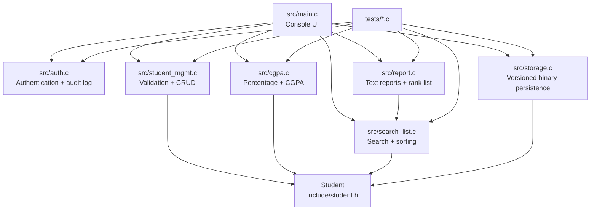

# StudentRMS

StudentRMS is a modular C11 console application for managing student academic records. It supports administrator authentication, validated record management, search and sorting, automatic percentage/CGPA calculation, persistent storage, rank-list generation, report export, and audit logging.


## Features

- Administrator login with hidden interactive password entry, failed-attempt lockout, and authentication audit logging
- Add, update, delete, search, and list student records
- Case-insensitive roll-number identity across search, duplicate checks, update, and delete
- Sorting by CGPA/rank, name, or roll number
- Input validation for names, departments, semesters, marks, and duplicate rolls
- Automatic percentage and CGPA calculation
- Versioned binary persistence with checksum validation and safe replacement writes
- Text export containing all student records and an academic rank list
- Headless unit, regression, robustness, and performance tests
- GitHub Actions verification on Linux GCC and Windows MinGW

## Screenshots

StudentRMS is currently a terminal-based application. A representative first launch and login flow looks like this:

```text
[INFO] First launch: created students.dat with sample records.
============================================================
    StudentRMS - Student Record Management System
    Team 4 | Software Engineering (UE24CS341A)
    Sprint 2 Working Product
============================================================

[ADMINISTRATOR LOGIN REQUIRED]
Username: admin
Password: ********

>>> Authentication successful. Welcome, Administrator. <<<
```

After login, the main menu provides the record-management workflows:

```text
============================================================
                 StudentRMS Main Menu
============================================================
  1. View All Students
  2. Add Student Record
  3. Update Student Record (FR-005)
  4. Delete Student Record (FR-006)
  5. Search by Roll Number
  6. Search by Name
  7. Generate Rank List / Sort by CGPA
  8. Sort Alphabetically by Name
  9. Sort by Roll Number
 10. Export Student and Rank Reports (FR-011)
 11. View Authentication Audit Log
 12. Logout and Exit
============================================================
Enter option [1-12]:
```

For a complete reproducible demonstration sequence, see [`docs/SPRINT2_DEMO_CHECKLIST.md`](docs/SPRINT2_DEMO_CHECKLIST.md) and the recorded validation results in [`docs/SPRINT2_RELEASE_VERIFICATION.md`](docs/SPRINT2_RELEASE_VERIFICATION.md).

## Requirements

### Linux/macOS

- GCC or another C11-compatible compiler
- GNU Make

### Windows

- MinGW-w64 GCC
- GNU Make, or the provided `build.bat` script

## Build and run

From the repository root:

```bash
make clean
make all
./studentrms_app
```

The application creates `students.dat` with six synthetic student records on first launch. Runtime files such as `students.dat`, `reports.txt`, and `login.log` are created in the current working directory.

On interactive terminals, the password is not echoed while typing. Non-interactive/piped sessions retain the bounded line-input path used by CI.

On Windows, use a MinGW-w64 terminal or PowerShell with MinGW on `PATH`:

```bat
cmd /c build.bat
studentrms.exe
```

## Demo credentials

The current educational/demo build uses:

```text
Username: admin
Password: admin123
```

These credentials are hard-coded for the demonstration product and must not be reused for a production deployment.

## Testing

Build and run all standard test suites:

```bash
make test
```

The test targets cover integrated functionality, search/list behavior, Sprint 2 regression scenarios, robustness cases, and the 1,000-record performance benchmark.

Run coverage instrumentation with GCC and gcov:

```bash
make coverage
```

For the full test matrix, manual validation checklist, and evidence requirements, see [`docs/TEST_EXECUTION_GUIDE.md`](docs/TEST_EXECUTION_GUIDE.md).

## Architecture

The application uses a small modular architecture. `src/main.c` owns the console workflow and coordinates the modules through public headers in `include/`.



### Module map

| Module | Responsibility |
| --- | --- |
| `src/main.c` | Startup, menu flow, input handling, and application orchestration |
| `src/auth.c` | Login verification, session state, and `login.log` audit events |
| `src/student_mgmt.c` | Student validation and add/update/delete operations |
| `src/cgpa.c` | Derived percentage and CGPA calculations |
| `src/search_list.c` | Roll/name search, listing, and multi-attribute sorting |
| `src/storage.c` | Versioned binary load/save, checksums, and safe file replacement |
| `src/report.c` | Student report and CGPA rank-list export |
| `tests/` | Headless unit, regression, robustness, and performance tests |

## Repository layout

```text
include/                 Public module headers and Student data model
src/                     Production C11 implementation
tests/                   Automated test programs
docs/planning/           Backlog, sprint allocation, and submission guides
docs/sprints/            Sprint reviews and implementation notes
docs/demos/              Reproducible demonstration scripts
docs/deliverables/       Assignment PDFs and final deliverables
docs/reports/            Technical and viva documentation
docs/                    Test guides, reports, traceability, and release evidence
.github/workflows/       Linux, Windows, and coverage CI workflows
Makefile                 Linux/macOS build, test, coverage, and clean targets
build.bat                Windows/MinGW build script
```

## Team

| Member | Identifier | Main responsibilities |
| --- | --- | --- |
| Samiksha Jayanth | `PES1UG24CS414` | Authentication, session gating, audit logging, and team coordination |
| Rohan M | `PES1UG24CS381` | Search, listing, sorting, and performance benchmark |
| Saksham Bajpayi | `PES1UG24CS404` | Student management, validation, update, and delete workflows |
| Riddhi Mundada | `PES1UG24CS372` | CGPA/rank calculations, persistent storage, and report export |

## Further documentation

- [`docs/TEST_EXECUTION_GUIDE.md`](docs/TEST_EXECUTION_GUIDE.md) — build, test, coverage, and manual validation commands
- [`docs/SRS_COMPLETION_ADDENDUM.md`](docs/SRS_COMPLETION_ADDENDUM.md) — three additional functional requirements, two security objectives, and accepted demo credential deviation
- [`docs/STP_COMPLETION_ADDENDUM.md`](docs/STP_COMPLETION_ADDENDUM.md) — detailed test-plan sections and execution responsibilities
- [`docs/SAD_INTERFACE_DESIGN_ADDENDUM.md`](docs/SAD_INTERFACE_DESIGN_ADDENDUM.md) — module responsibilities, interfaces, error contracts, and traceability
- [`docs/SECURITY_REQUIREMENT_GAP.md`](docs/SECURITY_REQUIREMENT_GAP.md) — accepted academic-demo credential decision and SEC-001 deviation
- [`docs/SYSTEM_VALIDATION_REPORT.md`](docs/SYSTEM_VALIDATION_REPORT.md) — reconciled validation results and remaining limitations
- [`docs/PART3_DELIVERABLES_README.md`](docs/PART3_DELIVERABLES_README.md) — test reports and Part 3 evidence index
- [`docs/SPRINT2_DEMO_CHECKLIST.md`](docs/SPRINT2_DEMO_CHECKLIST.md) — reproducible interactive demo flow
- [`BACKLOG_SPRINT_BOARD.md`](docs/planning/BACKLOG_SPRINT_BOARD.md) — requirements, ownership, and sprint status
- [`EXPLANATION_GUIDE.md`](docs/reports/EXPLANATION_GUIDE.md) — technical and viva explanation for the search/list module
- [`PR_SUBMISSION_GUIDE.md`](docs/planning/PR_SUBMISSION_GUIDE.md) — contribution and submission guidance

## License

No open-source license has been declared yet. Treat this repository as an academic project unless the owners add a license.
